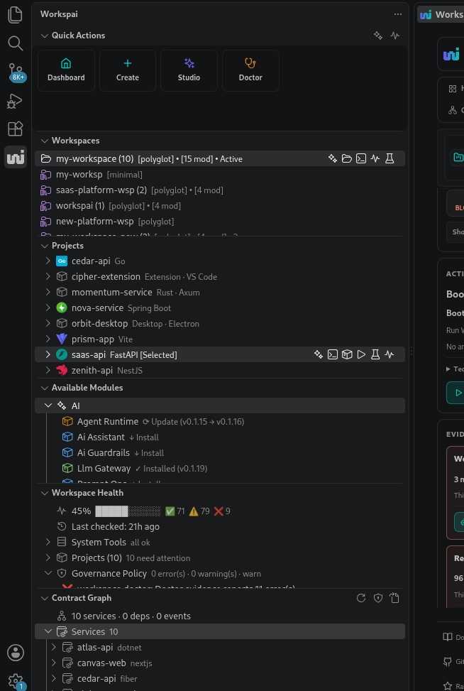

# Workspai for VS Code

### AI coding, grounded in your workspace.

Chat with your codebase, plan changes, edit files, run tests, and create projects
from inside VS Code. Workspai combines an AI coding assistant with workspace
intelligence: a shared view of your projects, dependencies, and supporting evidence.

[Install extension](https://marketplace.visualstudio.com/items?itemName=rapidkit.rapidkit-vscode) · [Documentation](https://www.workspai.dev/) · [GitHub](https://github.com/chistiq/rapidkit-vscode)

<strong>Ask → inspect → change → test → verify</strong>

## Start in minutes

1. [Install Workspai](https://marketplace.visualstudio.com/items?itemName=rapidkit.rapidkit-vscode).
2. Open an existing repository or start a new workspace in VS Code.
3. Open the **Workspai** sidebar and start a chat or create a project.
4. Choose an available model or configure your provider, then describe the task.

Start with an existing repository; Workspai registration is optional. Try:

- "Explain how authentication works in this project."
- "Add a regression test for this bug and run the relevant checks."
- "Create a separate workspace with a Next.js frontend and a NestJS API."

On first use, the extension downloads and integrity-checks its pinned Workspai
CLI runtime, then reuses the cached copy offline. A separate global CLI install
is not required for extension-owned operations.

## New in 0.49.0 · November 2, 2026

Work on existing projects without mandatory adoption, preview attached images,
and review each task's file changes above the composer. A compact chat picker
and activity grouped by response keep conversations focused.
[Read the release notes](RELEASE_NOTES.md).

## One assistant, four ways to work

| Mode      | Best for                                                            |
| --------- | ------------------------------------------------------------------- |
| **Ask**   | Understanding code, architecture, diagnostics, and workspace state. |
| **Plan**  | Investigating a task and preparing a grounded, read-only plan.      |
| **Agent** | Editing code, running scoped checks, and verifying the result.      |
| **Goal**  | Pursuing a defined outcome with explicit checks and progress.       |

Ask and Plan stay read-only. Agent and Goal can make scoped changes and report
the checks performed, their results, and any remaining verification.

## Understand your codebase

Workspai connects source code with projects, dependencies, contracts, diagnostics,
and documentation. The Assistant can use this context alongside source search,
project commands, web research, and enabled VS Code/MCP tools.

### Create

Describe the workspace or project you want. Workspai prepares a clear plan for
review before it creates files or runs setup commands.

### Assistant

Use one conversational loop to inspect evidence, edit source, run project
commands, review changed files, and verify the outcome. When an operation needs
permission, the Assistant shows an approval card in the conversation. You can
run it once, allow the exact action for the session or project when supported,
or decline it.

An ordinary Agent task does not need an incident card or Workspai registration.
Select an existing project and describe the task. Adoption in place or import of
a copy into Workspai requires approval. You can continue ordinary project work
without registering it.

Review file changes and exact diffs above the composer, then Keep changes or
Restore the task checkpoint. Follow activity for each response, inspect command
output, and stop running work. Attached images have thumbnails and full previews.

### Graph

Explore how projects, modules, files, APIs, and dependencies connect. Select an
entity to inspect its relationships and supporting evidence.

### Live

Follow active commands, completed stages, failures, check results, and model usage.
Operations Floor brings workspace activity, Graph context, and supporting evidence
into one view.

### Artifacts

Open the generated Model, Graph, agent context, Skills, reports, and other
workspace evidence without searching through internal directories.

## Safe without getting in the way

- Read-only investigation can run without unnecessary prompts.
- Source changes are scoped, recorded, and reversible where supported.
- Sensitive or invasive actions require an explicit, exact approval.
- Check results and unfinished verification are reported explicitly.
- Agent changes can carry their intent, observed effects, and verification as
  one inspectable record.

## Choose your model

Use models available through VS Code, including those exposed by GitHub Copilot,
or configure a supported API provider or local model. Codex and Grok model
availability depends on your provider, account access, and configuration.

`VS Code Models` · `OpenAI` · `Claude` · `Gemini` · `Kimi` · `DeepSeek` ·
`OpenRouter` · `Groq` · `Mistral` · `xAI (Grok)` · `Ollama` · `Custom`

Provider credentials are stored in VS Code Secret Storage. Tool and image support
depends on the selected model and enabled providers.

## Learn more

- [Getting started](docs/GETTING_STARTED.md)
- [CLI Repair Engine integration](docs/CLI_REPAIR_ENGINE_INTEGRATION.md)
- [Release notes](RELEASE_NOTES.md)
- [Workspai CLI](https://www.npmjs.com/package/workspai)
- [Contributing](CONTRIBUTING.md)
- [Issues and feature requests](https://github.com/chistiq/rapidkit-vscode/issues)

MIT © [Chistiq](https://github.com/chistiq)
